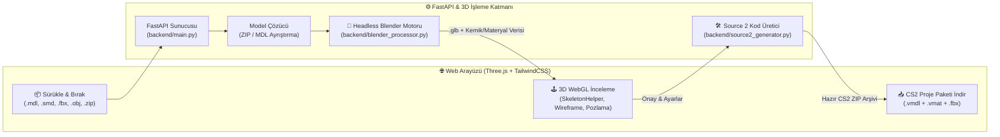

<div align="center">

# 🎨 Luminar CS2 3D Model Porting Tool *(Beta)*

**Source 1 (CS:GO) ve 3D Modelleri Headless Blender (`bpy`) & Three.js ile Source 2 (CS2) Altyapısına Taşıyan Otomatik 3D Web Pipeline Aracı**  
*Automated Web-Based 3D Asset & Skeleton Porting Pipeline from Source 1 / FBX / OBJ / SMD to Counter-Strike 2 (Source 2)*

[-f59e0b?style=for-the-badge)](#)
[](https://www.python.org/)
[](https://fastapi.tiangolo.com/)
[](https://www.blender.org/)
[](https://threejs.org/)
[](https://tailwindcss.com/)

</div>

---

> [!IMPORTANT]
> **🚧 Beta Sürümü Bildirimi (Beta Release Notice):**  
> Bu proje şu anda **Beta** aşamasındadır. Temel 3D model ayrıştırma, Headless Blender (`bpy`) ile otomatik origin sıfırlama, `.glb` dönüşümü, iskelet (`SkeletonHelper`) incelemesi ve Source 2 (`.vmdl` / `.vmat`) proje şablonu üretimi aktif olarak çalışmaktadır. Otomatik kemik yeniden eşleme (bone retargeting), PBR doku (texture) fırınlama ve doğrudan Workshop derleme adımlarıyla **çok daha ileri seviyeye taşınmaya açık bir mimari temel** sunar.

---

## 🌟 Genel Bakış (Overview)

**Luminar CS2 3D Model Porting Tool**, eski Source 1 (`CS:GO` `.mdl` / `.smd`) veya standart 3D model formatlarını (`.fbx`, `.obj`, `.zip` arşivleri) **Counter-Strike 2 (Source 2)** motoruna hazırlama sürecini otomatize eden web tabanlı bir 3D işleme boru hattıdır (pipeline).

Arka planda **FastAPI** ve **arayüzsüz (headless) Blender (`bpy`)** motorunu çalıştırarak yüklenen modelleri normalize eder, merkez noktasını (origin) sıfırlar, materyalleri ayrıştırır ve tarayıcı üzerinde **Three.js** ile gerçek zamanlı 3D/iskelet (armature) kontrolü yaptıktan sonra tek tıkla **Source 2 (`.vmdl` & `.vmat`)** proje paketi olarak dışa aktarır.

---

## 🏗️ Sistem Mimarisi (Pipeline Architecture)



---

## ✨ Temel Özellikler (Key Features)

- **🤖 Headless Blender (`bpy`) Otomasyonu:** Blender arayüzünü açmaya gerek kalmadan arka planda geometriyi temizler, ölçek/rotasyon dönüşümlerini uygular ve merkezi sıfırlar.
- **🦴 Gerçek Zamanlı İskelet (Bone/Armature) Görselleştirme:** Three.js `SkeletonHelper` entegrasyonu ile modelin kemik hiyerarşisini tarayıcıda canlı olarak inceleme ve test etme.
- **📦 Çoklu Format ve ZIP Desteği:** Tekil `.fbx`, `.obj`, `.smd`, `.mdl` dosyalarının yanı sıra dokularıyla birlikte sıkıştırılmış `.zip` arşivlerini otomatik tarar.
- **🛠️ Otomatik Source 2 (`.vmdl` & `.vmat`) Üretimi:** CS2 Workshop Tools ile uyumlu Valve Model (`.vmdl`) ve Valve Material (`.vmat`) tanım dosyalarını otomatik oluşturup indirilebilir `.zip` paketi haline getirir.
- **🌑 Modern Geliştirici Arayüzü:** Karanlık tema (Dark Mode), sürükle-bırak yükleme alanı, materyal listesi ve sahne ışık/grid kontrolleri.

---

## 📂 Proje Dizini (Project Structure)

```text
Luminar-CS2-Model-Tool/
├── backend/
│   ├── main.py                  # FastAPI sunucusu, dosya yükleme ve dışa aktarma uç noktaları
│   ├── blender_processor.py     # Headless Blender (bpy) 3D model işleme ve GLB/FBX dönüştürücü
│   └── source2_generator.py     # CS2 (.vmdl / .vmat) şablon ve proje paketi üreticisi
├── frontend/
│   ├── index.html               # TailwindCSS tabanlı 3D stüdyo arayüzü
│   └── app.js                   # Three.js sahne motoru, GLTFLoader, OrbitControls ve API istemcisi
├── requirements.txt             # Python bağımlılıkları (FastAPI, Uvicorn, bpy vb.)
└── başlat.bat                   # Windows için hızlı başlatma betiği
```

---

## 🚀 Kurulum ve Çalıştırma (Getting Started)

### 1. Ön Koşullar
- **Python 3.10 veya 3.11** (`bpy` modülü uyumluluğu için önerilir)

### 2. Kurulum
```bash
# Sanal ortam oluşturun ve aktif edin
python -m venv venv
venv\Scripts\activate

# Bağımlılıkları yükleyin
pip install -r requirements.txt
```

### 3. Başlatma
Windows üzerinde doğrudan `başlat.bat` dosyasına çift tıklayabilir veya terminalden başlatabilirsiniz:
```bash
cd backend
uvicorn main:app --reload --host 127.0.0.1 --port 8000
```
Tarayıcınızda **`http://localhost:8000`** adresine giderek 3D stüdyoyu kullanmaya başlayabilirsiniz.

---

## 🗺️ Gelecek Yol Haritası (Roadmap — Beta Sonrası Geliştirme Fikirleri)

- [ ] **Otomatik Kemik Yeniden Eşleme (Auto Bone Retargeting):** Source 1 (`valvebiped`) kemik isimlerinin CS2 iskelet yapısına otomatik dönüştürülmesi.
- [ ] **PBR Doku Dönüştürücü:** Klasik Phong/Diffuse dokuların Source 2 PBR (`Color`, `Normal`, `Roughness`, `Metalness`) kanallarına otomatik ayrıştırılması.
- [ ] **Animasyon (`.smd` / `.anim`) Önizleme:** Silah inceleme (`inspect`), ateş etme (`fire`) ve şarjör değiştirme (`reload`) animasyonlarının tarayıcıda oynatılması.
- [ ] **Çoklu Model Kuyruğu (Batch Processing):** Birden fazla modelin sırayla işlenip toplu CS2 paketi olarak indirilmesi.

---

## 📄 Lisans (License)

Bu proje **MIT Lisansı** altında açık kaynak olarak sunulmuştur.
